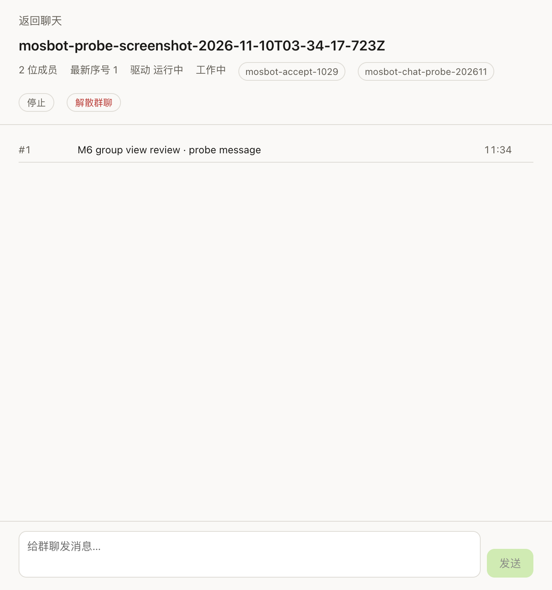

# M6 · 只读群名单 · 证据

[English](m6-group-roster.md)

- 卡片：M6（群聊自 2026-11-10 进入首版范围）
- 状态：**只读名单、带成员标签与 Markdown 消息的状态/日志视图、创建弹层、输入框、发送、3 秒日志/状态轮询、停止、审批（拒绝与允许一次）、错误呈现与模拟 socket 断开恢复已在真实服务验证；语音与附件在该部署不可用**
- 记录时间：2026-11-10
- 目标服务：`192.168.2.171:9119`（v0.22.5 / `bf0203a794`）

## 实现

- `RemoteGroup` 共享类型、`groups.list` 校验 schema、`ChatManager.listGroups()` 与
  `chatListGroups()` bridge/preload/IPC。
- 渲染层把只读房间列表存入 `remote.groups`，在 Bot Chat 连接可用后拉取一次。
- 侧栏新增「群聊」分区，每个房间一行（头像、名称、成员数）。
- 点击群聊打开视图：房间元数据（成员数、成员标签、最新序号、驱动状态）、最近 50 条日志事件（有文本时按 Markdown 渲染）与输入框。输入框已接 `groups.send`，使用推导的 `thread_id` 与客户端事件 id。
- 侧栏「群聊」分区新增创建按钮与小型创建弹层（名称 + 2–6 个本地 profile）；创建成功后刷新名单并打开新群。
- 群视图可在二次确认后解散房间；解散后刷新名单并清除选择。
- 群视图打开时定位到最新 50 条事件窗口（由房间最新序号推导），随后向前轮询；当首条可见序号大于 1 时提供「加载更早消息」。成员回复显示显示名；隐藏内部 `turn.settled` 行并本地化 driver 状态。发送/停止/审批后从最后已见序号追加新事件，不再替换窗口，历史与新消息都保留。
- 群名单为空时「群聊」分区与创建按钮仍显示；显示加载/错误状态并提供重试；重复选择当前房间不重置；侧栏标记当前打开的房间。
- 待处理群审批（`kind=approval`）以横幅显示，提供「允许一次 / 拒绝」；处理时调用 `groups.approve` 并追加房间状态/日志。其他 pending action 类型不会显示为审批。
- 群视图打开时每 3 秒轮询 `groups.log` 与 `groups.state`：按 seq 去重、更新最新序号、刷新 working/blocked driver 状态、自动滚动并呈现轮询错误（后续成功轮询会清除）；reducer 覆盖在 `tests/unit/store.test.ts`。

## 真实窗口截图

截图裁切为群聊主区域（不含侧栏），使用专用探针群，截图后已解散。

## 验证

- 命令：`node scripts/gui-groups-roster.mjs`（真实 Dashboard + 专用探针 userData）。
- 结果：2 个 hosted rooms 正确渲染，成员数匹配：
  - `Group Chat` · 4 位成员
  - `Mosbot Ui 041400、devbot` · 2 位成员
- 点击第一个房间渲染视图：标题 `Group Chat`、50 条日志事件、最新序号 86、驱动 `running`、输入框与发送按钮存在。
- 专用群验证：`node scripts/gui-group-send.mjs` 用两个本地 profile 创建临时群，发送一条消息，在群日志中找到该消息后解散群。
- 群审批验证：`node scripts/gui-group-approval.mjs` 触发真实待审批、拒绝并确认清除；`node scripts/gui-group-approval-ui.mjs` 从弹层创建群、看到审批横幅、点击拒绝并确认清除（`created=true`、`approvalSeen=true`、`denied=true`、`cleared=true`、`disbanded=true`）；`node scripts/gui-group-approval-allow.mjs` 用 UI 路径验证允许一次（`allowed=true`、`cleared=true`）。
- 部署公布 18 个 `groups.*` 方法，不包含 `groups.attachment.*`；群附件属于部署能力缺口，不是客户端缺口。
- 解散 UI 验证：`node scripts/gui-group-disband-ui.mjs` 创建群、确认解散并确认从名单消失（`created=true`、`confirmed=true`、`removed=true`）。
- 端到端 UI 验证：`node scripts/gui-group-create-send.mjs` 从弹层创建群、在输入框发送消息、由 3 秒轮询渲染出来、点击停止（`stopped=true`）并解散房间（`created=true`、`sent=true`、`rendered=true`、`disbanded=true`）。
- 历史验证：`node scripts/gui-groups-roster.mjs` 加载更早一页，原始日志从 50 条增长到 86 条（可见消息行 30 → 46，因为隐藏了 `turn.settled`）；`loadedEarlier=true`。
- 重连验证：`node scripts/gui-group-reconnect.mjs` 在群视图打开时断开 gateway socket；房间保持选中、detail/log 恢复、轮询错误清除（`recovered=true`）。重连状态太快未观察到（`sawReconnect=false`），因此这是模拟 socket 断开，不是真实断网。
- `vitest` 176 passed；typecheck/lint/format 全绿。
- 报告（工作区忽略数据）：`docs/evidence/tmp/groups-roster-*.json`。

## 部署能力限制

- 部署未公布 `groups.attachment.*`（18 个 `groups.*` 方法）；群附件被服务端能力阻塞。
- 语音录音/转写在该无头部署仍不可用（`wake.status available=false`）。
- 语音与附件跟踪于 Issue #20。

## 下一步

1. 用真实断网加固错误/重连状态。
2. 附件需要部署公布 `groups.attachment.*`；语音录音/转写保持独立，直到有具备能力的部署/设备。
