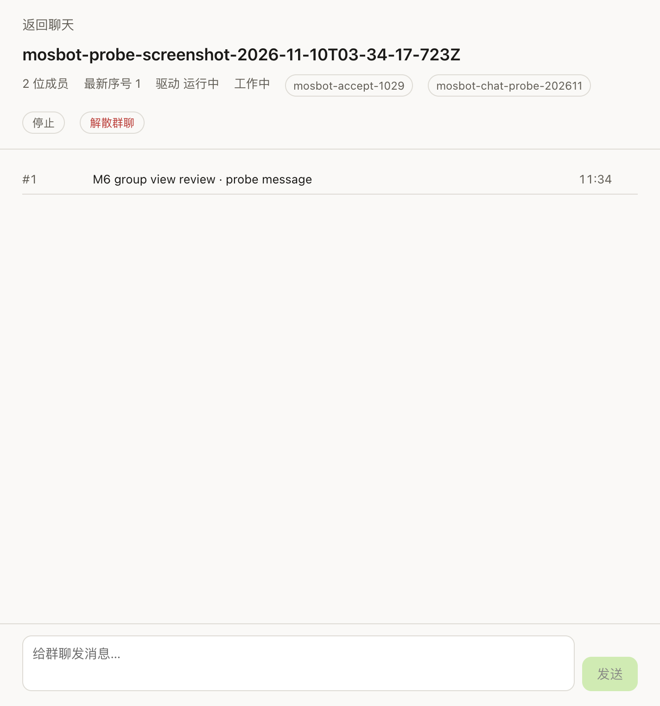

# M6 · Group Chat · Evidence

[简体中文](m6-group-roster-zh.md)

- Card: M6 (group chat in first-release scope since 2026-11-10)
- Status: **conversation UI implemented after the 2026-11-10 design rejection (member avatars/names, bubbles, date separators, inline request cards); verified against the real service and awaiting user review. Voice and attachments remain unavailable on this deployment**
- Recorded: 2026-11-10
- Target service: `192.168.2.171:9119` (v0.22.5 / `bf0203a794`)

## Implementation

- `RemoteGroup` shared type, validated `groups.list` schema, `ChatManager.listGroups()` and the
  `chatListGroups()` bridge/preload/IPC method.
- Renderer stores the read-only room list in `remote.groups` and fetches it once a Bot Chat connection is live.
- Sidebar renders a "Groups" section with the same pinned-style avatar tiles as Bot entries: overlapping group faces, name, selected state.
- Clicking a group opens a conversation with a centered group nameplate (avatar cluster, name, member count), member messages with avatar/display name/bubble, right-aligned user bubbles, date separators, centered system notices and inline approval/retry cards. The composer is wired to `groups.send` with a derived `thread_id` and a client event id.
- The sidebar Groups section has a create button and a small create dialog (name + 2–6 local profiles); on success the roster refreshes and the new room opens.
- The group view can disband a room after an explicit confirmation; the roster refreshes and the selection clears.
- The message list is an ARIA log (`aria-live=polite`) for polled additions; a floating down button appears when new messages arrive while the reader is scrolled up.
- The group view opens on the latest 50-event page (derived from the room's latest sequence), polls forward, and offers "Load earlier messages" while the first visible sequence is above 1. Member replies show their display name; internal `turn.settled` rows are hidden and driver status is localized. After send/stop/approval it appends new events from the last seen sequence instead of replacing the window, so history and the new message stay visible.
- The Groups section and its create button stay visible when the roster is empty; it shows loading/error states with retry/refresh actions; selecting the already-open room is a no-op; the open room is marked in the sidebar.
- Pending group approvals (`kind=approval`) appear as an inline card with Allow once / Deny; resolving one calls `groups.approve` and appends the new state/log. `kind=retry` actions get a Retry button wired to `groups.retry`; other pending kinds render as informational rows without actions.
- While the group view is open, the renderer polls `groups.log` and `groups.state` every 3 s from the last seen seq, de-duplicates by seq, updates the latest sequence, refreshes working/blocked driver state, auto-scrolls and surfaces poll errors (a later successful poll clears them); reducer coverage is in `tests/unit/store.test.ts`.

## Real-window screenshot

The screenshot is clipped to the group surface (sidebar excluded) and uses a dedicated probe room that was disbanded afterwards.

## Verification

- Command: `node scripts/gui-groups-roster.mjs` (real Dashboard, dedicated probe userData).
- Result: 2 hosted rooms rendered with matching member counts:
  - `Group Chat` · 4 members
  - `Mosbot Ui 041400、devbot` · 2 members
- Clicking the first room rendered the conversation: heading `Group Chat`, 30 visible message rows (86 raw events), latest seq 86, driver `running`, composer and send button present.
- Dedicated-group verification: `node scripts/gui-group-send.mjs` created a temporary hosted room from two local profiles, sent one message, found it in the room log and disbanded the room.
- Group approval verification: `node scripts/gui-group-approval.mjs` triggered a real pending approval, denied it and saw it clear; `node scripts/gui-group-approval-ui.mjs` created a group from the dialog, saw the approval banner, clicked Deny and saw it clear (`created=true`, `approvalSeen=true`, `denied=true`, `cleared=true`, `disbanded=true`). `node scripts/gui-group-approval-allow.mjs` repeated the UI path with Allow once (`allowed=true`, `cleared=true`).
- The deployment advertises 18 `groups.*` methods and does not include `groups.attachment.*`; group attachments are therefore a deployment capability gap, not a client gap.
- Disband UI verification: `node scripts/gui-group-disband-ui.mjs` created a group, confirmed disband and saw it disappear from the roster (`created=true`, `confirmed=true`, `removed=true`).
- End-to-end UI verification: `node scripts/gui-group-create-send.mjs` created a group from the dialog, sent a message from the composer, saw it rendered by the 3 s poll, clicked Stop (`stopped=true`) and disbanded the room (`created=true`, `sent=true`, `rendered=true`, `disbanded=true`).
- History verification: `node scripts/gui-groups-roster.mjs` loaded the earlier page and grew the raw log from 50 to 86 events (visible message rows 30 → 46 because `turn.settled` is hidden); `loadedEarlier=true`.
- Reconnect verification: `node scripts/gui-group-reconnect.mjs` dropped the gateway socket while a group view was open; the room stayed selected, detail/log recovered and the poll error cleared (`recovered=true`). The reconnecting state was too fast to observe (`sawReconnect=false`), so this is a simulated socket drop, not a real network outage.
- `vitest` 179 passed; typecheck/lint/format green.
- Report (ignored working data): `docs/evidence/tmp/groups-roster-*.json`.

## Deployment capability limits

- `groups.attachment.*` is not advertised by the deployment (18 `groups.*` methods); group attachments are blocked on the server side.
- Voice recording/transcription remains unavailable on the headless deployment (`wake.status available=false`).
- Voice and attachments are tracked in Issue #20.

## Next

1. Error/reconnect hardening with a real network drop.
2. Attachments need a deployment that advertises `groups.attachment.*`; voice recording/transcription stays separate until a capable deployment/device is available.
